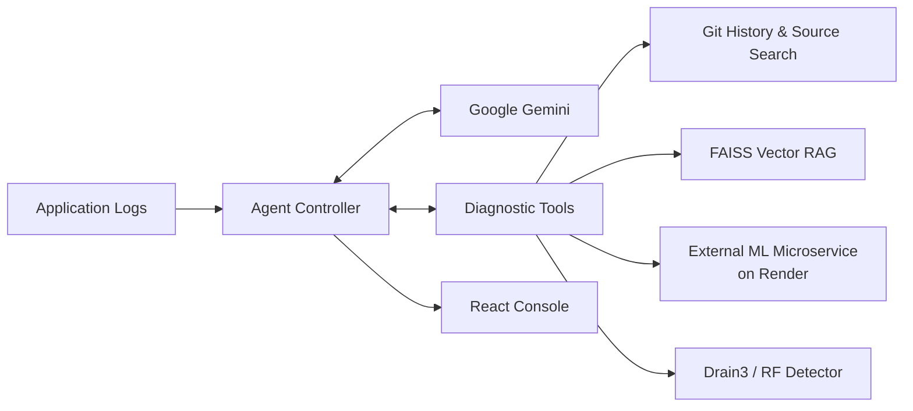
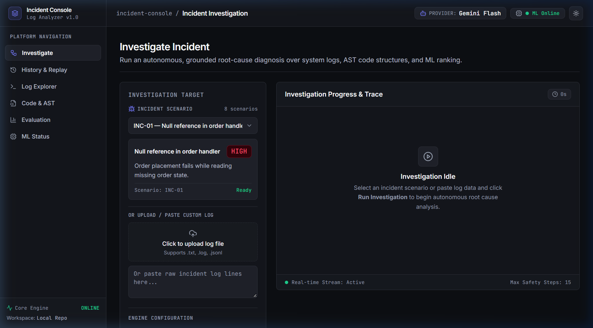

# Incident Agent V2

[](https://www.python.org/downloads/)
[](https://fastapi.tiangolo.com)
[](https://react.dev)
[](https://ai.google.dev)
[](LICENSE)

An incident investigation and log analysis application. It uses **Google Gemini** for diagnosis (when configured), **FAISS with TF-IDF vectors** for local documentation retrieval, an optional **external ML inference service** for log ranking, and a **Drain3 / Random Forest** detector trained for HDFS block-session logs.

---

## Architecture Overview



### Core Components

- **Reasoning Engine:** Google Gemini tool-calling investigation with file/function reference checks, Git history tools, and an offline fallback.
- **External ML Microservice:** Independently deployed on Render (`incident-ml-service.onrender.com`) for log classification and suspect line ranking.
- **Technical Documentation RAG:** In-memory FAISS cosine-similarity index over TF-IDF vectors for the README and incident catalog.
- **Target Simulation:** FastAPI sample e-commerce application with 8 reproducible incident modes (`INC-01` to `INC-08`).
- **Investigation Console:** React 18 / Vite / Tailwind UI with dark/light themes, investigation event streaming, history, and timeline replay.

### Capability Scope

- The investigator accepts pasted or uploaded text logs and can analyze PNG, JPEG, GIF, or WebP error screenshots with Gemini. Screenshot bytes are sent to Google for analysis.
- The log viewer reads the bundled sample application log; it is not a live telemetry ingestion service.
- The local anomaly model is only applicable to HDFS block-session logs. Other log formats are reported as unsupported by that detector.
- Repository analysis uses bounded text search and file reads; AST call-graph traversal is not implemented.
- The app returns suggested remediation text. Automatic patch generation, ready-to-merge diffs, and patch application are not implemented; the patch-apply API returns HTTP 501.

---

## Quick Start

### 1. Installation

```powershell
python -m venv .venv
.\.venv\Scripts\Activate.ps1
python -m pip install -r requirements.txt
cd frontend && npm install && cd ..
```

### 2. Environment Setup

Create `.env` from `.env.example`:
```powershell
Copy-Item .env.example .env
```
Key variables:
- `GEMINI_API_KEY`: Required for Gemini natural-language reasoning.
- `LLM_MODEL`: Optional Gemini model override.
- `ML_MODEL_API_URL`: URL of the external ML service (`https://incident-ml-service.onrender.com`).

### 3. Run Locally

Open separate terminals:

```powershell
# Terminal 1: Backend API
uvicorn api.main:app --reload --port 8000

# Terminal 2: Sample Target App
uvicorn sample_app.main:app --reload --port 8001

# Terminal 3: Frontend Console
cd frontend && npm run dev
```

Open **`http://127.0.0.1:5173`** in your browser.

On the investigation page, choose an error screenshot in the same upload control used for logs, then select **Analyze Image**. Images are sent to the configured Gemini API.

### 4. Simulate Incident Traffic

Generate reproducible incident traffic against the target app:
```powershell
python -m sample_app.traffic --url http://127.0.0.1:8001 --incident INC-07
```

---

## Testing

Run the automated test suite (36 unit & integration tests):
```powershell
python -m pytest -q
```

Build the frontend for production:
```powershell
cd frontend && npm run build
```

---

## Primary API Endpoints

| Endpoint | Method | Description |
| :--- | :--- | :--- |
| `/api/investigations` | `POST` | Start an autonomous incident investigation |
| `/api/investigations/{id}` | `GET` | Get status, final diagnosis report, and grounded evidence |
| `/api/investigations/{id}/stream` | `GET` | SSE stream of live agent thoughts and tool calls |
| `/api/models/status` | `GET` | Health check for Gemini, RAG index, and external ML service |
| `/api/logs` | `GET` | Read and filter bundled sample logs |
| `/api/images/analyze` | `POST` | Analyze a PNG, JPEG, GIF, or WebP image with Gemini (raw image body) |

---

## Preview



---

## License

Distributed under the MIT License. See [LICENSE](LICENSE) for details.
