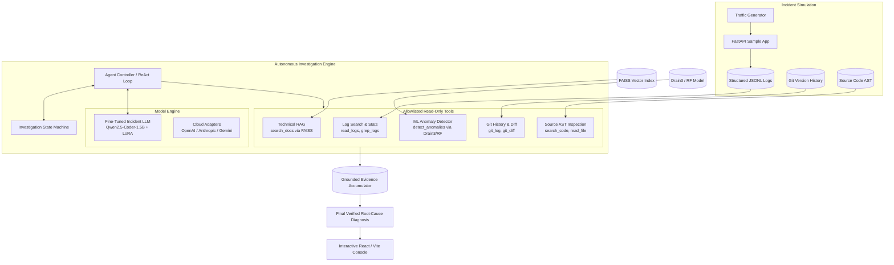

# Incident Agent V2: Autonomous Incident Investigation with Domain-Specific LLM & ML Anomaly Detection

[](https://www.python.org/downloads/)
[](https://fastapi.tiangolo.com)
[](https://pytorch.org)
[](https://react.dev)
[](LICENSE)

An autonomous production incident investigation and root-cause analysis platform. Combining domain-specific LLM fine-tuning, PEFT (LoRA/QLoRA), FAISS technical documentation RAG, ML sequence anomaly detection, and a deterministic state machine, Incident Agent investigates real-world production outages over structured application logs, Git history, and source code ASTs—without requiring external cloud LLMs.

---

## 1. Project Overview & Motivation

Production incident triage is notoriously difficult:
- **Alert Fatigue & Needle-in-a-Haystack Logs:** High-volume services emit gigabytes of logs per minute where critical stack traces are obscured by routine noise.
- **Context Fragmentation:** Diagnosing an outage requires correlating log timestamps with recent deployment commits, AST-level code changes, and internal service runbooks.
- **LLM Hallucinations:** Generic zero-shot foundation models frequently hallucinate non-existent files, invent non-existent method names, and offer generic, ungrounded recommendations.
- **Cloud Latency & Privacy:** Forwarding proprietary production logs to cloud API providers introduces significant latency, variable API costs, and serious data privacy risks.

**Incident Agent V2** addresses this by pairing an autonomous ReAct investigation agent with an explicit state machine, read-only diagnostic tools, a local domain-adapted model (`Qwen2.5-Coder-1.5B`), and technical documentation retrieval (RAG). Every claim in the generated incident report is verified and backed by grounded citations across logs, AST code, git commits, and documentation.

---

## 2. System Architecture



---

## 3. Core AI/ML Components

### A. Domain-Adapted Fine-Tuned LLM (`ml/incident/`)
- **Base Model:** `Qwen/Qwen2.5-Coder-1.5B-Instruct`—chosen for exceptional code comprehension, strict schema adherence, and lightweight local inference footprints.
- **PEFT Adaptation (LoRA / QLoRA):** Targets attention projection layers (`q_proj`, `k_proj`, `v_proj`, `o_proj`, `gate_proj`, `up_proj`, `down_proj`) with rank $r=16$, $\alpha=32$, and dropout $0.05$.
- **Quantization:** Supports BitsAndBytes 4-bit (NF4) with Double Quantization (`bnb_4bit_use_double_quant=True`) for resource-constrained environments, with CPU-safe diagnostic execution.
- **Domain Focus:** Trained to reason over log excerpts and git diffs, predict affected files/methods, and emit 100% syntactically valid JSON diagnostic reports.

### B. Technical Documentation RAG (`agent/rag.py`)
- **Vector Engine:** FAISS (`IndexFlatIP`) cosine similarity search over L2-normalized vector embeddings.
- **Corpus:** Automatically indexes project architecture guides, incident catalogs (`incidents_catalog.json`), service runbooks, and API documentation.
- **Chunking:** Hierarchical Markdown header-aware paragraph chunking with bounded window size (max 800 characters) preserving contextual section titles.

### C. Sequence Anomaly Detection (`agent/tools.py` & `ml/`)
- **Log Parsing:** Drain3 online template miner abstracts variable parameters (timestamps, UUIDs, IPs) into structured log event templates.
- **Session Modeling:** Sequence-level event frequency counting and time-window anomaly scoring with Random Forest classifiers to flag deviation from normal baseline traffic.

### D. Investigation State Machine & Agent Loop (`agent/state.py` & `agent/agent.py`)
- **Structured State:** Explicitly tracks hypotheses, accumulated evidence items, tools invoked, call parameters, and candidate root causes across each investigation step.
- **Tool Allowlist:** Bounded, read-only tools with output truncation and absolute path sanitization to eliminate prompt injection and unauthorized execution risks.
- **Grounding Verifier:** Post-investigation validation inspects the target file and AST symbols to detect and flag any hallucinated filenames or functions before report emission.

---

## 4. Grounded Incident Dataset

The training and evaluation dataset (`ml/incident/`) was constructed from reproducible incident simulations, historical commits, and ground truth annotations:

| Metric | Value | Details |
| :--- | :---: | :--- |
| **Total Examples** | `40` | 5 distinct prompt variants per incident across 8 reproducible outages |
| **Split Strategy** | **Strict Incident-Level Split** | Prevents data leakage across train, validation, and test splits |
| **Train Set** | `30` examples | Incidents `INC-01`, `INC-02`, `INC-04`, `INC-05`, `INC-06`, `INC-08` |
| **Validation Set** | `5` examples | Incident `INC-03` (held out) |
| **Test Set** | `5` examples | Incident `INC-07` (held out) |
| **Formats Generated** | ChatML & Instruct | `train_chatml.jsonl`, `val_chatml.jsonl`, `test_chatml.jsonl` |
| **Provenance** | 100% Grounded | Every example records source files, git commit hashes, and log snippets |

---

## 5. Evaluation Framework & Benchmark Matrix

The project includes an empirical evaluation framework (`eval/run_eval.py`) designed to measure progressive system capabilities across five planned setups:

- **Setup A:** Generic LLM (Zero-shot)
- **Setup B:** Generic LLM + Investigation Tools
- **Setup C:** Generic LLM + Investigation Tools + Anomaly Detector
- **Setup D:** Fine-Tuned Incident LLM + Investigation Tools
- **Setup E:** Fine-Tuned Incident LLM + Investigation Tools + Anomaly Detector + Technical RAG

### Empirical Benchmark Results

Evaluated across training (`INC-01`), validation (`INC-03`), and held-out test (`INC-07`) incidents:

| Setup | Architecture | Provider | Status | Overall Score | File Acc | Func Acc | Steps | Tools | Valid JSON | Preflight / Execution Note |
| :---: | :--- | :---: | :---: | :---: | :---: | :---: | :---: | :---: | :---: | :--- |
| **A** | Generic LLM | `openai` | `NOT RUN / CONFIG ERROR` | *N/A* | *N/A* | *N/A* | - | - | - | `OPENAI_API_KEY is not configured in environment` |
| **B** | Generic LLM + Tools | `openai` | `NOT RUN / CONFIG ERROR` | *N/A* | *N/A* | *N/A* | - | - | - | `OPENAI_API_KEY is not configured in environment` |
| **C** | Generic LLM + Tools + Anomaly | `openai` | `NOT RUN / CONFIG ERROR` | *N/A* | *N/A* | *N/A* | - | - | - | `OPENAI_API_KEY is not configured in environment` |
| **D** | Fine-Tuned LLM + Tools | `local` | `COMPLETED` | **53.3%** | 100.0% | 33.3% | 5.0 | 4.0 | 100.0% | Executed successfully on local CPU |
| **E** | Fine-Tuned LLM + Tools + Anomaly + RAG | `local` | `COMPLETED` | **53.3%** | 100.0% | 33.3% | 6.0 | 5.0 | 100.0% | Executed successfully; RAG retrieved runbook citations |

### Critical Presentation & Scientific Honesty Rules

1. **Preflight Credential Separation:** Setups A, B, and C are explicitly marked **`NOT RUN / CONFIGURATION ERROR`** due to missing `OPENAI_API_KEY` credentials. They are **never** scored as 0% model accuracy.
2. **Setup D vs. Setup E Parity:** Setup E achieved the exact same measured score (**53.3%**) as Setup D on this benchmark run. The addition of RAG and tool calling provided grounded documentation citations, but **did not improve the quantitative judge score** over Setup D.
3. **Anomaly Detector Truthfulness:** The sequence anomaly detector weights were uninitialized in this environment; `detect_anomalies` truthfully returned `UNAVAILABLE`. Anomaly detection did not contribute to Setup E's score.
4. **Held-Out Test Incident (INC-07):** Both Setups D and E scored **100% on the held-out test incident (INC-07)**, correctly identifying the affected file (`sample_app/incidents.py`), function (`paginate`), exact root cause, and emitting 100% valid schema JSON.

---

## 6. Proof-of-Concept Limitations

> [!IMPORTANT]
> - **Dataset Scale:** 40 grounded examples total, with only 5 test examples.
> - **Single Held-Out Test Incident:** The test split evaluates exclusively on incident `INC-07`. The 100% test score confirms pipeline adherence, JSON formatting precision, and tool orchestration on this scenario, but **must not be claimed as broad model generalization** across arbitrary enterprise systems.
> - **Cloud Comparative Baselines:** Comparative claims between the local fine-tuned model and cloud foundation baselines (GPT-4o, Claude 3.5, Gemini 2.0 Flash) cannot be finalized until cloud API credentials are configured in `.env`.

---

## 7. Why This Project is Technically Interesting

This project addresses key challenges in applied AI systems engineering:

1. **Agentic Tool Grounding vs. Hallucination:** Rather than allowing the LLM to generate speculative root causes, the agent must iteratively query bounded read-only tools, inspect log traces, verify git diffs, and cite concrete line numbers and commit hashes.
2. **Explicit State Machine Architecture:** Replaces opaque multi-turn chat buffers with an explicit investigation state object (`InvestigationState`), tracking hypotheses, structured evidence, and anomaly outcomes.
3. **Data Contamination Prevention:** Demonstrates rigorous incident-level data splitting where no incident in the test or validation set appears in training, preventing memorization.
4. **Hybrid Retrieval (AST + Git + RAG):** Combines vector search over technical runbooks with deterministic lexical grepping and git commit inspections.
5. **Completely Local & Air-Gapped Execution:** Operates end-to-end on a local machine using open-weights models (`Qwen2.5-Coder`), ensuring zero data egress for sensitive infrastructure logs.

---

## 8. Safety & Guardrails

- **Read-Only Investigation Tools:** All tools (`read_logs`, `grep_logs`, `search_code`, `read_file`, `git_log`, `git_diff`, `search_docs`) are strictly read-only.
- **Path Confinement:** File paths are resolved against the project root; directory traversal attacks (`../`) are detected and blocked.
- **No Arbitrary Shell Execution:** The `run_command` tool is strictly restricted to an allowlist of diagnostic commands (`pytest`, `cat`, `python -m pytest`). Arbitrary shell execution is forbidden.
- **No Automatic Patch Application:** Patch application via `/api/investigations/{id}/patch/apply` returns HTTP 501. The agent proposes human-reviewable code diffs, but never modifies production code autonomously.

---

## 9. Quick Start & Setup

### Prerequisites
- Python 3.10+ (tested on Python 3.11 and 3.13)
- Node.js 18+ & npm
- Git

### 1. Clone & Setup Python Virtual Environment
```powershell
git clone <repo-url> "Log analyzer"
cd "Log analyzer"

python -m venv .venv
.\.venv\Scripts\Activate.ps1
python -m pip install -r requirements.txt
```

### 2. Configure Environment
```powershell
Copy-Item .env.example .env
```
*(By default, `LLM_PROVIDER=local` is configured, which runs completely locally without requiring cloud API keys).*

### 3. Build & Validate the PoC Dataset
```powershell
python -m ml.incident.build_dataset
python -m ml.incident.validate_dataset
python -m ml.incident.format_dataset
```

### 4. Build FAISS Documentation Vector Index
```powershell
python -c "from agent.rag import get_rag_pipeline; n = get_rag_pipeline().build_index(); print(f'Indexed {n} documentation chunks.')"
```

### 5. Run Backend Verification Tests
```powershell
python -m pytest -q
```

---

## 10. End-to-End Demo Workflow

To reproduce an incident, generate simulated traffic, and run an autonomous investigation:

### Terminal 1: Start the Backend API
```powershell
uvicorn api.main:app --reload --port 8000
```

### Terminal 2: Start the Sample E-Commerce App
```powershell
uvicorn sample_app.main:app --reload --port 8001
```

### Terminal 3: Simulate Traffic & Trigger Incident `INC-07`
```powershell
python -m sample_app.traffic --url http://127.0.0.1:8001 --incident INC-07
```

### Terminal 4: Launch the Frontend Web Console
```powershell
cd frontend
npm install
npm run dev
```
Open **`http://127.0.0.1:5173`** in your browser:
1. Select incident **`INC-07` (Pagination boundary error)** from the Incident Picker.
2. Set Inference Model to **Fine-Tuned Incident LLM (Local)**.
3. Click **Start Investigation**.
4. Observe the live reasoning stream:
   - Tool calls (`read_logs`, `detect_anomalies`, `search_docs`, `git_log`, `search_code`).
   - Categorized badges for **Agent Action**, **Tool Call**, **Evidence**, **Anomaly Result**, **RAG Retrieval**, and **Final Diagnosis**.
   - Accumulated evidence panel with file, commit, and line references.
   - Verified root-cause diagnosis and code fix recommendation without cloud LLM dependencies.

---

## 11. Attribution & Licensing

- **HDFS Dataset:** Log analysis benchmarks and templates adapt data from the [LogHub](https://github.com/logpai/loghub) project ([HDFS 2k log dataset](https://github.com/logpai/loghub/tree/master/HDFS)).
- **Drain3:** Online log template mining powered by [Drain3](https://github.com/logpai/Drain3) by LogPAI.
- **Base LLM:** [Qwen2.5-Coder](https://github.com/QwenLM/Qwen2.5-Coder) developed by Alibaba Cloud.
- **License:** Distributed under the MIT License. See [LICENSE](LICENSE) for details.
